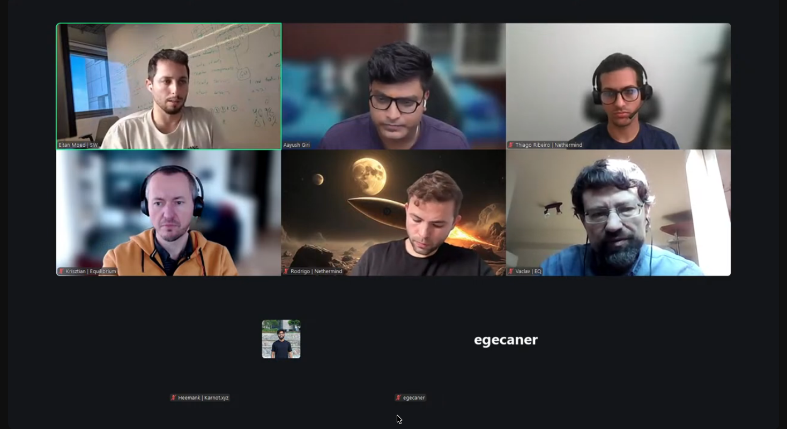

# Starknet All Core Devs Meeting #45
## Meeting Details

- **Date & Time:** Thursday, February 12, 2026, 12:00-12:30 PM UTC
- **Duration:** 30 minutes
- **YouTube:** https://www.youtube.com/watch?v=hW3febVDGTA
- **Agenda:** https://github.com/starknet-io/pm/issues/35
- **Moderator:** [Aayush Giri](https://github.com/Giri-Aayush)

## Meeting Screenshot

## Executive Summary

This meeting covered continued progress on decentralized validation preparations, a key update on v0.14.2 timelines, and steady client team progress across Pathfinder, Juno, and Madara. Key outcomes included:

- **v0.14.2 targeting integration around March 8, 2026** - Client-side proving upgrade on track; no anticipated RPC spec changes
- **Key management approach clarified** - Supporting both local keys and remote signing; operator key risk is lower due to Starknet's two-key architecture
- **Base fee adjustment SNIP posted** - Eitan published proposal on Starknet forum covering interim adjustments until a long-term sequencer revenue solution is built
- **Pathfinder JSON RPC 0.10.1 beta released** - Published shortly after Call #44; beta only, not for production; concurrent execution now implemented in validator code
- **Juno v0.15.18 shipped on January 30** - Database reduction confirmed (720 GB → ~370 GB); workers now scale with available CPU cores; RPC 0.10.1 RC planned week of February 16
- **Madara mainnet sync progressing** - Blocked on one very old class not compiling; merkleization optimization design under internal review
- **Malachite team absent fourth consecutive call** - No consensus update provided

## Meeting Notes

The meeting opened with [Aayush Giri](https://github.com/Giri-Aayush) welcoming attendees to Starknet All Core Devs Call #45. He covered the usual housekeeping—recording notice, muting protocol, and the standing 12:00 PM UTC time through end of March—and outlined four agenda items for the session.

### 1. Decentralized Validation Progress

Aayush opened by recapping that in Call #44 (January 29, 2026), [Eitan Moed](https://github.com/eitanm-starkware) had described Starkware's ongoing staker outreach and work across observability, key management, networking requirements, and sync time. He asked for a status update.

**Observability**

Eitan reported that conversations with staker communities and other blockchain ecosystems are converging on clear expectations. On observability, the consensus across ecosystems is that operators use a Prometheus-compatible metrics interface for scraping. Starkware already provides this interface and intends to continue doing so.

**Key Management Architecture**

On key management, Eitan explained that Starkware is evaluating solutions that support both local key storage and remote signing, allowing operators to choose whichever model fits their security posture. He highlighted a distinguishing characteristic of Starknet's architecture: the operator key used for attestations is separate from the staking key that controls the actual stake. This means losing an operator key carries lower financial risk—the worst-case outcome is getting blacklisted by peers for sending invalid attestations, not losing staked funds. That said, Eitan noted the team is still evaluating what the best key management solution looks like. Existing ecosystem options include TMKMS and Horcrux from the Tendermint/Cosmos stack and Web3Signer from the Ethereum ecosystem. The goal is to adopt or build a solution that does not significantly delay the decentralized validation rollout.

**Networking Requirements**

Eitan noted they are also researching common networking requirements across different chains. This is particularly relevant for protocol choices like Propeller, since each gossip protocol carries different bandwidth and connectivity expectations. Starkware wants to ensure operator requirements are reasonable without being too permissive.

**v0.14.2 Timeline and RPC Spec Status**

On protocol timelines, Eitan announced that v0.14.2—the client-side proving upgrade—is targeting integration deployment around **March 8, 2026**. He confirmed there are no anticipated changes to the JSON RPC spec at this stage. However, he is keeping the spec window passively open in case any requests come in before it needs to close, giving all client teams time to finalize compatible implementations.

**Base Fee Adjustment SNIP**

Eitan also flagged a SNIP he posted on Telegram and the Starknet forum in the days prior to the call. The proposal addresses an interim challenge: sequencer operational costs are largely USD-denominated (cloud and bare metal infrastructure), but transaction fees are paid in STRK. Until a complete long-term mechanism is designed to ensure sequencers can reliably cover operational costs from transaction revenue, the SNIP describes adjustments to be made in the interim. He directed interested parties to the Starknet forum for the full discussion.

**SNOS Changes for v0.14.2**

Aayush noted that in Call #44, Mohit from Karnot had raised a question about what SNOS changes might be needed for v0.14.2. Eitan confirmed that he and the relevant engineering contacts had addressed those questions privately with the Karnot team, and the open questions were resolved.

---

### 2. Client Team Updates

Aayush transitioned to client team updates, asking each team to keep their updates to approximately four to five minutes.

#### **Pathfinder** ([Krisztian Kovacs](https://github.com/kkovaacs)):

Krisztian confirmed that v0.21.5 remains the current stable Pathfinder release with no issues reported. A JSON RPC 0.10.1 pre-release (beta) was cut shortly after Call #44 concluded on January 29, 2026. The release notes and all communications make clear this is not intended for production use—there is no deployed public Starknet network running the new RPC features yet, so running the beta in production serves no purpose. Little feedback had been received on the beta at the time of the call.

On the validator and consensus implementation front, the team made two notable improvements in the preceding two weeks. First, they upgraded their execution component for re-executing proposals and transaction batches to use concurrent execution. As a side effect, this refactoring also simplified several areas of the codebase. Second, the team removed recovery logic from the consensus code that turned out to be unnecessary—the network recovers on its own without it, and the added complexity was not justified. The team is also investigating storage optimizations targeted at improving performance on high-latency storage, which is common in cloud deployments.

---

#### **Juno** ([Rodrigo Pino](https://github.com/rodrodros)):

Rodrigo confirmed that Juno v0.15.18 with the major database reduction shipped on January 30, 2026—the last day of January and a team milestone they had committed to. After two months of internal testing, the release went smoothly with no issues reported from the community.

The database size improvement came in as follows:

| Metric | Before | After |
|--------|--------|-------|
| Mainnet Database Size | ~720 GB | ~370–380 GB |
| Reduction | — | ~47–49% |

Beyond the size reduction, the release introduced meaningful new scalability knobs for operators. Prior to v0.15.18, Juno's performance did not scale with available hardware—it performed well but no better on a 64-core machine than on an 8-core machine. That changes with this release. Key new configurable parameters include:

- **Database compression**: Juno is moving to CDC as the default compression codec, but operators can select alternatives.
- **Main table (write buffer)**: Operators can now configure how long recently written data stays in memory before being flushed to disk. When an RPC request for recent data arrives while that data is still in the write buffer, Juno serves it from memory rather than hitting the database—improving response latency.
- **Worker count**: Previously, Juno used a single worker for all database operations. Workers now scale between one and half the available CPU core count, ensuring spare capacity is preserved while making full use of available hardware. On a 64-core machine, up to 32 workers can be configured.

More tunable parameters are planned in future releases as the team continues to identify database performance as the primary bottleneck.

Rodrigo also shared two other areas of progress. On the consensus side, a long-standing gap has been closed: when a Juno node was running consensus and fell behind the network, it previously could not catch up because P2P sync was not integrated with the consensus path. That has now been fixed—nodes can request missing blocks from peers and re-sync successfully. On the roadmap, work on the improved state trie is continuing, with the goal of shipping the trie changes and the RPC v0.10.1 release candidate—planned for the week of February 16—alongside other backlog items in a release before the end of February.

---

#### **Karnot/Madara** ([Heemank Verma](https://github.com/heemankv)):

Heemank provided updates across the three areas flagged by Mohit in Call #44.

On mainnet sync, the team remains blocked by a class that is not compiling correctly. It is a very old class in the chain's history, and the investigation is ongoing. There is no resolution timeline yet.

On merkleization optimization, the team has a design in progress and is testing it internally with experimental PRs. The core problem is that closing a block takes longer than expected, and the solution involves restructuring how the merkle tree updates are batched and applied. Heemank noted the design would be shared with the wider team once it has been thoroughly reviewed internally.

The team also spent time over the previous two weeks clearing technical debt across the Orchestrator and SNOS components.

On RPC 0.10.1, the starknet-rs pull request received a review approximately two to three days before the call (around February 9–10, 2026). Once the review feedback is addressed and the PR is merged, the team will be unblocked to complete RPC 0.10.1 support on the Madara side, with a merge expected shortly after.

---

### 3. Consensus Implementation Updates (Skipped)

The Malachite team from Informal Systems was not present. Aayush has been informed that the Malachite team will no longer be attending these calls going forward. No consensus update was provided.

---

### 4. Any Other Business

Aayush opened the floor for additional topics or questions. No items were raised, and the call moved to closing remarks.

---

### 5. Closing Remarks

Aayush thanked all attendees for their updates and closed the session.

**Reminders:**
- Next call: Thursday, February 26, 2026, 12:00 PM UTC
- Recording will be published on the YouTube channel
- Meeting notes will be shared on GitHub

---

## Key Decisions Summary

1. **v0.14.2 Integration Target: March 8, 2026**
   - Client-side proving upgrade targeting integration deployment around March 8
   - No anticipated RPC spec changes; window being kept passively open

2. **Key Management to Support Both Local and Remote Signing**
   - Operators will be able to choose between local key storage and remote signing solutions
   - Starknet's two-key architecture (staking key vs. operator key) reduces operator key risk

3. **Juno Database Scalability Parameters Now Configurable**
   - v0.15.18 introduced configurable compression, write buffer, and worker count
   - Performance now scales with available hardware

4. **Pathfinder JSON RPC 0.10.1 Beta Released**
   - Available for testing only; v0.21.5 remains the stable production release
   - No public Starknet network is yet running the new RPC features

5. **Juno P2P Consensus Catch-Up Fixed**
   - Nodes running consensus can now re-sync via P2P after falling behind

---

## Action Items Tracker

| Owner | Action | Target Date/Call | Status |
|-------|--------|------------------|--------|
| Starkware | Finalize and close RPC spec for v0.14.2 | Before March 8, 2026 | In Progress |
| Starkware | Progress Apollo validator packaging (observability, key mgmt, networking) | Ongoing | In Progress |
| [Eitan Moed](https://github.com/eitanm-starkware) | Base fee adjustment SNIP community discussion | Ongoing | Open |
| [Krisztian Kovacs](https://github.com/kkovaacs) | Continue consensus/validator implementation (storage optimizations) | Call #46 | In Progress |
| [Rodrigo Pino](https://github.com/rodrodros) | Release Juno RPC v0.10.1 release candidate | Week of Feb 16, 2026 | In Progress |
| [Rodrigo Pino](https://github.com/rodrodros) | Ship improved state trie and backlog items in release | End of February 2026 | In Progress |
| Karnot team | Resolve mainnet class compilation issue blocking mainnet sync | TBD | Blocked |
| Karnot team | Complete starknet-rs PR review and merge for RPC 0.10.1 | Shortly after review | In Progress |
| Karnot team | Finalize and share merkleization optimization design | After internal vetting | In Progress |
| [Aayush Giri](https://github.com/Giri-Aayush) | Communicate Malachite non-attendance to the community | Call #46 | Planned |

---

## Attendees

- **Moderator:** Aayush Giri | Nethermind
- egecaner
- Eitan Moed | Starkware
- Heemank Verma | Karnot
- Krisztian Kovacs | Equilibrium
- Rodrigo Pino | Nethermind
- Stephan
- Vaclav | Equilibrium

---

## Glossary

- **v0.14.2**: Upcoming Starknet upgrade introducing client-side proving; targeting integration March 8, 2026
- **Client-Side Proofs**: Feature allowing full nodes and clients to generate transaction proofs independently
- **Operator Key**: Signing key used for validator attestations; separate from the staking key that controls staked funds
- **Staking Key**: Key controlling the actual staked STRK; not used in day-to-day validator operations
- **Remote Signing**: Key management approach where signing operations are delegated to a dedicated signing service (e.g., Web3Signer, TMKMS, Horcrux)
- **TMKMS / Horcrux**: Tendermint Key Management System and its high-availability variant used in Cosmos ecosystem
- **Web3Signer**: Ethereum ecosystem remote signing service
- **Base Fee SNIP**: Starknet Improvement Proposal for interim adjustments to transaction base fees pending a long-term sequencer revenue mechanism
- **Concurrent Execution**: Parallel processing of transaction batches; adopted in Pathfinder's validator implementation
- **CDC Compression**: Juno's new default database compression codec introduced in v0.15.18
- **Main Table (Write Buffer)**: Database buffer that keeps recently written data in memory; improves RPC response latency for recent data
- **Merkleization**: Process of updating Merkle tree state after each block; identified as a major performance bottleneck (60–80% of sequencing/sync time)
- **State Trie**: Data structure encoding the full Starknet state; Juno working on an improved version for better storage efficiency
- **Malachite**: BFT consensus engine by Informal Systems; team has confirmed they will no longer be attending these calls
- **Apollo**: Starkware's sequencer implementation used as the reference for validator implementation work

---

**Next Meeting:** Thursday, February 26, 2026, 12:00 PM UTC

**Note:** These Starknet All Core Devs Calls occur bi-weekly at the same time. All interested parties are encouraged to join and contribute to the ongoing discussions and development efforts.

**⏰ TIME REMINDER: Calls are at 12:00 PM UTC through the end of March.**
