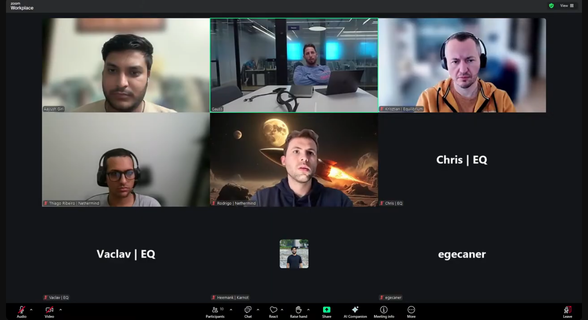

# Starknet All Core Devs Meeting #46
## Meeting Details

- **Date & Time:** Thursday, February 26, 2026, 12:00-12:30 PM UTC
- **Duration:** 30 minutes
- **YouTube:** https://www.youtube.com/watch?v=9shyOE31V4M
- **Agenda:** https://github.com/starknet-io/pm/issues/36
- **Moderator:** [Aayush Giri](https://github.com/Giri-Aayush)

## Meeting Screenshot

## Executive Summary

This meeting opened with an unplanned disclosure of a testnet reorg the day prior, followed by a v0.14.2 timeline update and decentralized validation progress. Key outcomes included:

- **Testnet reorg on February 25** - New block hash calculation code caused a hash collision edge case; code has been disabled; mainnet unaffected
- **v0.14.2 integration target March 8 still tentative** - May slip due to testnet incident investigation; new RPC RC3 with proof type change expected same day
- **Propeller version decision reached** - Two-tier networking requirements finalized based on stake level; engineering spec to be presented at Call #47
- **Key management interface design agreed** - API between operator key management solutions and Apollo to be documented and shared as an open spec
- **Pathfinder awaiting RPC RC3** - Feedback received on 0.10.1 beta; proof representation changes implemented; breaking WebSocket config requirement coming
- **Juno v0.16 scope defined** - DB migration becomes mandatory; new improved trie included but opt-in; default RPC version changing to v0.10
- **Madara SNOS v0.14.1 finally merged** - Starknet-rs unblocked; memory fix PR (30% reduction) submitted to LambdaClass VM; merkleization parallelization showing 2-3x TPS gains

## Meeting Notes

The meeting opened with [Aayush Giri](https://github.com/Giri-Aayush) welcoming everyone to Starknet All Core Devs Call #46. He covered the usual housekeeping—recording notice, muting protocol, and the 12:00 PM UTC slot continuing through end of March—and outlined three sections: Starkware updates, client team updates, and any other business.

### 1. Starkware Updates

#### Network Health: Testnet Reorg (February 25, 2026)

Before moving to planned agenda items, Aayush asked [Eitan Moed](https://github.com/eitanm-starkware) for a network health check given it had been two weeks since the last call.

Eitan disclosed that testnet had experienced downtime and a reorg the previous day, February 25, 2026. Mainnet was stable throughout and was at no risk.

**Root Cause:**

New code deployed to testnet introduced the ability for individual sequencers to calculate the block hash locally. A discrepancy arose between one sequencer's calculation and the rest. The underlying cause was specific to low-traffic conditions on testnet: the block hash was derived from a state diff that was nearly empty of transactions. Because the resulting hash was the same across two consecutive rounds, a proposer was able to reuse that hash to re-enter the same storage slot it believed was unique to the previous round. This created an overwrite condition that propagated to the proving system.

**Resolution:**

Eitan clarified that this is not an open issue on mainnet. The new block hash calculation code has been disabled on testnet, preventing the condition from recurring while the team investigates and applies a fix.

---

#### v0.14.2 Timeline and RPC Status

Aayush noted that at Call #45 (February 12, 2026), the target for v0.14.2 integration was March 8, 2026, and asked whether that still held.

Eitan confirmed the team is still targeting March 8, but acknowledged there is a possibility of a delay depending on how the testnet investigation progresses. If a delay becomes necessary, Starkware will post an update approximately by the following week.

On the RPC side, a small change has been made to v0.14.2: proofs are now sent using a different type. This change needs to be reflected in a new release candidate, RC3, which had been expected a couple of days prior to the call but remained delayed. Eitan expressed hope that RC3 would be posted and shared by end of that day.

---

#### Base Fee SNIP Progress

Aayush asked about progress on the base fee SNIP that Eitan had posted prior to Call #45. Eitan confirmed that a fee adjustment has already been applied based on the current STRK/USDC ratio. This is an interim measure and will continue to be adjusted on an ongoing basis until a full protocol-level solution is in place.

---

#### Decentralized Validation: Propeller Version and Key Management

Aayush asked for an update on the staker conversations and the key decisions from Call #45—specifically on Prometheus for observability, the Propeller version choice, and key management.

**Propeller Version Decision:**

Eitan confirmed a decision has been reached on which version of Propeller to implement. The design accommodates two tiers of networking requirements:

- **Standard tier**: For validators with normal to above-average stake
- **High-stake tier**: For validators with a very high amount of stake in the network

The engineering details and full specification will be presented at Call #47 by the relevant engineers.

**Key Management Interface:**

An agreement has been reached on the interface design between operator key management solutions and the Apollo sequencer node. Eitan noted that once this is written up as formal documentation, it will be shared openly across the ecosystem—inviting full node teams and other sequencer implementations to adopt this as a standard API for accessing signing tools, analogous to how the JSON RPC spec serves as a common interface for full nodes.

**Hardware Stack:**

Eitan noted that in the coming weeks, the team will review the hardware stack with the goal of making it more operator-friendly.

---

### 2. Client Team Updates

#### **Pathfinder** ([Krisztian Kovacs](https://github.com/kkovaacs)):

Krisztian confirmed that v0.21.5 remains the stable recommended release for both mainnet and testnet, and that this will remain the case until the v0.14.2 network upgrade.

**JSON RPC 0.10.1 Beta Feedback:**

The beta released shortly after Call #44 has generated useful feedback. The team identified several areas where Pathfinder's implementation did not match the specification. Additionally, Eitan's announcement of proof representation type changes in the RPC means a new beta will be needed. Pathfinder has already implemented the proof representation changes on its main branch and is now waiting for RC3 of the JSON RPC spec to be published before cutting a new beta release.

**Upcoming Breaking Change — WebSocket Requirement:**

Krisztian flagged an upcoming breaking configuration change. Pathfinder has always required a WebSocket connection to the Ethereum node. For approximately the past year, the team provided a compatibility workaround that automatically converted HTTP/HTTPS Ethereum node URLs to WebSocket. That conversion code has now been removed. The next major Pathfinder release will therefore require operators to explicitly configure a WebSocket URL for their Ethereum client. Krisztian emphasized this is a straightforward configuration change and will be clearly documented in release notes, but operators should be aware it is coming.

---

#### **Juno** ([Rodrigo Pino](https://github.com/rodrodros)):

**v0.15.18 Adoption:**

Rodrigo reported that the majority of users have already migrated to v0.15.18, which is a positive sign given the significant database size reduction it provides. No issues have been reported since the release.

**RPC 0.10.1 Pre-Release:**

A Juno pre-release supporting the latest JSON RPC 0.10.1 RC is already available in the release notes. Once RC3 is published, the team will update accordingly.

**v0.16 Scope:**

Rodrigo outlined the planned scope for Juno v0.16:

- **Mandatory DB migration**: The database migration that was opt-in in v0.15.18 becomes mandatory in v0.16. Users who had not yet migrated will be required to do so.
- **New state trie (opt-in initially)**: An improved trie implementation is under review and will ship as part of v0.16, but will not be immediately set as default. Operators will be able to enable it via a flag, which triggers a migration from the old trie to the new one. The improved trie is more correct, delivers better performance, and unlocks future capabilities such as snap sync. It will follow the same rollout pattern as the DB migration—opt-in first, then becoming the default in a subsequent release.
- **Default RPC version change**: The default RPC version will be updated to v0.10 (the latest).
- Other minor changes are planned but the list is not large.

---

#### **Karnot/Madara** ([Heemank Verma](https://github.com/heemankv)):

**Mainnet Sync:**

The fix for the old class compilation issue blocking mainnet sync has been implemented and is currently under testing. Heemank expects to have an update—whether the team has successfully synced to mainnet tip or not—by Call #47.

**SNOS v0.14.1 Merged:**

After a prolonged wait, the Dojo team completed their review and approved all outstanding Karnot PRs. SNOS v0.14.1 is now fully released.

**Starknet-rs Unblocked:**

The team resolved their starknet-rs blocker by adding the latest types. This unblocks the RPC 0.10.1 implementation on Madara and allows the team to continue with the latest spec.

**Memory Optimization (SNOS/LambdaClass VM):**

The team identified that their orchestrator was experiencing memory issues, traced to unoptimized memory usage in SNOS. A pull request has been submitted to the LambdaClass VM repository targeting a **30% reduction in memory consumption**. The PR is currently open and awaiting review.

**Fraud Readiness and Technical Debt:**

The team has been working on fraud readiness checks, improving admin routes, and strengthening revert logic. Several smaller technical debt items have also been addressed.

**200,000 Block Settlement Milestone:**

As a validation test, the team produced and settled 200,000 blocks end-to-end through their downstream pipeline on the L1 testnet. This demonstrates the reliability of the full Madara sequencer and settlement stack.

**Merkleization Parallelization Results:**

Following the internal testing of the merkleization design discussed at Call #45 (February 12, 2026), Heemank shared initial results. The team implemented parallelization that allows the creation of additional pre-confirmed blocks to continue while block hash calculation for other blocks is in progress. Results have been available internally for approximately one week, showing a **2–3x TPS improvement** at minimum. The full numbers will be shared in the full node Telegram group.

---

### 3. Consensus Implementation Updates (Skipped)

The Malachite team from Informal Systems was not present. As communicated to Aayush directly, the Malachite team has confirmed they will no longer be attending these calls. Consensus was not included on the agenda for this call, and no update was provided.

---

### 4. Any Other Business

Aayush opened the floor for additional topics. No items were raised.

---

### 5. Closing Remarks

Aayush thanked all attendees for their updates and closed the session.

**Reminders:**
- Next call: Thursday, March 12, 2026, 12:00 PM UTC
- Recording will be published on the YouTube channel
- Meeting notes will be shared on GitHub

---

## Key Decisions Summary

1. **Testnet Block Hash Calculation Code Disabled**
   - New sequencer-side block hash calculation caused a hash collision edge case on testnet (February 25, 2026)
   - Code disabled; mainnet unaffected; investigation ongoing
   - v0.14.2 March 8 target may slip depending on findings

2. **RPC RC3 Imminent with Proof Type Change**
   - Proofs to be sent using a new type in v0.14.2
   - RC3 was expected by end of day February 26; all client teams to update implementations upon release

3. **Propeller Two-Tier Networking Requirements Finalized**
   - Standard requirements for normal to above-average stake validators
   - Higher requirements for very high-stake validators
   - Full engineering spec to be presented at Call #47

4. **Key Management API to be Published as Open Spec**
   - Interface between operator key management tools and Apollo agreed upon
   - Will be documented and shared across ecosystem for full node teams and sequencer implementations

5. **Juno v0.16 DB Migration Becomes Mandatory**
   - Optional migration from v0.15.18 becomes required in v0.16
   - New improved trie ships opt-in in v0.16; default in future release

6. **Malachite Team Confirmed Non-Attendance**
   - Malachite team from Informal Systems has confirmed they will no longer attend these calls
   - Consensus updates will not be a standing agenda item going forward

7. **Pathfinder WebSocket Ethereum Client Requirement**
   - Automatic HTTP → WebSocket URL conversion removed
   - Next major release will require explicit WebSocket configuration

---

## Action Items Tracker

| Owner | Action | Target Date/Call | Status |
|-------|--------|------------------|--------|
| Starkware | Investigate and fix testnet block hash collision issue | Before March 8, 2026 | In Progress |
| Starkware | Post update if v0.14.2 March 8 target is delayed | ~Week of March 2, 2026 | Pending |
| [Eitan Moed](https://github.com/eitanm-starkware) | Publish RPC RC3 with proof type changes | End of day Feb 26, 2026 | In Progress |
| Starkware | Present Propeller engineering spec and details | Call #47 | Planned |
| Starkware | Write up key management API documentation and share as open spec | Coming weeks | In Progress |
| Starkware | Review hardware stack for operator-friendliness | Coming weeks | Planned |
| [Krisztian Kovacs](https://github.com/kkovaacs) | Cut new Pathfinder beta with proof type changes after RC3 | Shortly after RC3 | In Progress |
| [Krisztian Kovacs](https://github.com/kkovaacs) | Document and release WebSocket Ethereum client requirement | Next major release | In Progress |
| [Rodrigo Pino](https://github.com/rodrodros) | Release Juno v0.16 with mandatory DB migration and new trie | TBD | In Progress |
| [Rodrigo Pino](https://github.com/rodrodros) | Update Juno RPC pre-release after RC3 published | Shortly after RC3 | In Progress |
| Karnot team | Complete mainnet sync testing and confirm sync status | Call #47 | In Progress |
| Karnot team | Get LambdaClass VM memory optimization PR (30% reduction) merged | TBD | In Progress |
| Heemank Verma | Share merkleization parallelization benchmark numbers in full node group | This week | In Progress |
| [Aayush Giri](https://github.com/Giri-Aayush) | Communicate Malachite non-attendance to the community | Call #47 | Planned |

---

## Attendees

- **Moderator:** Aayush Giri | Nethermind
- Chris | Equilibrium
- egecaner
- Eitan Moed | Starkware
- Heemank Verma | Karnot
- Krisztian Kovacs | Equilibrium
- Rodrigo Pino | Nethermind
- Vaclav | Equilibrium

---

## Glossary

- **v0.14.2**: Starknet upgrade introducing client-side proving; targeting integration March 8, 2026 (subject to delay)
- **Block Hash Calculation**: Process of computing the canonical hash of a proposed block; new code allowing sequencer-side calculation caused testnet reorg
- **Hash Collision Edge Case**: Condition where a sparse state diff produces an identical block hash across consecutive rounds, enabling unintended storage slot reuse
- **RPC RC3**: Third release candidate of the JSON RPC 0.10.1 specification; includes proof representation type changes for v0.14.2
- **Proof Type Change**: RPC modification in v0.14.2 where proofs are serialized using a different type than in previous versions
- **Propeller Two-Tier Networking**: Finalized design with separate bandwidth/connectivity requirements for standard-stake vs. high-stake validators
- **Key Management API Spec**: Planned open specification defining the interface between operator signing tools and the Apollo sequencer; analogous to the JSON RPC spec for full nodes
- **WebSocket Ethereum Client**: Required connection type for Pathfinder's Ethereum node; automatic HTTP→WebSocket conversion is being removed in the next major release
- **Improved State Trie**: New Juno trie implementation with better correctness, higher performance, and future snap sync compatibility; ships opt-in in v0.16
- **Snap Sync**: Fast synchronization method that downloads state snapshots rather than replaying all blocks; enabled by the new trie
- **LambdaClass VM**: Virtual machine implementation used by SNOS; Karnot submitted a PR reducing memory consumption by 30%
- **Fraud Readiness**: Preparation for fraud proof submission in a decentralized context; includes admin routes and revert logic improvements
- **Merkleization Parallelization**: Madara optimization allowing pre-confirmed block creation to proceed concurrently with block hash calculation; shows 2–3x TPS gains
- **Pre-confirmed Blocks**: Blocks accepted by the sequencer before final block hash computation is complete
- **SNOS v0.14.1**: Starknet OS version for v0.14.1; Dojo team review completed and release is now out
- **Malachite**: BFT consensus engine by Informal Systems; team has confirmed they will no longer be attending these calls

---

**Next Meeting:** Thursday, March 12, 2026, 12:00 PM UTC

**Note:** These Starknet All Core Devs Calls occur bi-weekly at the same time. All interested parties are encouraged to join and contribute to the ongoing discussions and development efforts.

**⏰ TIME REMINDER: Calls are at 12:00 PM UTC through the end of March.**
